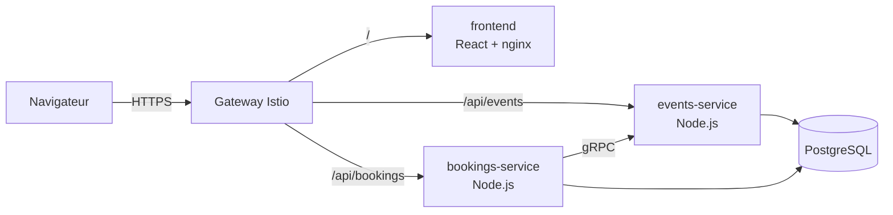

# Compte rendu de conception : CampusEvents

**Module :** Intégration Cloud
**Binôme :** _à compléter_
**Date :** 24 novembre 2026
**État :** étapes 1 à 4 codées et testées ; étapes 5 à 7 à faire

## 1. Le projet

CampusEvents permet de consulter les événements d'un campus (conférences, soirées, tournois) et d'y réserver une place.

Fonctionnalités :

1. Lister les événements avec leur nombre de places restantes.
2. Créer et supprimer un événement.
3. Réserver une place avec son nom et son e-mail.
4. Consulter et annuler ses réservations.

Le métier est volontairement réduit, car le critère d'évaluation le plus important est l'intégration des technologies. La règle « pas de réservation si l'événement est complet » suffit à justifier deux services qui communiquent.

**Hors périmètre :** comptes utilisateurs, mots de passe, paiement, envoi d'e-mails. L'e-mail saisi sert d'identifiant sans être vérifié : n'importe qui peut donc consulter les réservations d'un autre. Cette limite est à annoncer à la soutenance.

## 2. Architecture



| Composant | Technologie | Port | Rôle |
|---|---|---|---|
| `frontend` | React, Vite, servi par nginx | 8080 | Interface web |
| `events-service` | Node.js 22, Express | 3001 (REST), 50051 (gRPC) | Événements et places |
| `bookings-service` | Node.js 22, Express | 3002 (REST) | Réservations |
| `postgres` | PostgreSQL 16 | 5432 | Deux bases : `events_db` et `bookings_db` |
| Gateway | Istio | 80, 443 | Point d'entrée unique |

### Choix techniques

| Choix | Raison |
|---|---|
| Node.js plutôt que Java | Images légères, peu de code, pas de compilation. Autorisé par le sujet. |
| REST vers l'extérieur, gRPC en interne | REST est simple pour le front ; gRPC apporte le bonus. |
| Une instance PostgreSQL, deux bases | Chaque service garde sa base et son utilisateur, sans multiplier les pods. |
| Mémoire puis PostgreSQL | `DB_MODE=memory` ou `postgres`. Le sujet conseille de commencer en mémoire. |
| Ingress puis Istio | L'Ingress valide l'étape 12/20. Istio le remplace ensuite, et les deux ne tournent pas ensemble (voir section 6). |

## 3. Contrats

### REST

| Méthode | Route | Effet | Codes |
|---|---|---|---|
| GET | `/api/events` | Liste des événements | 200 |
| GET | `/api/events/:id` | Détail | 200, 404 |
| POST | `/api/events` | Création | 201, 400 |
| DELETE | `/api/events/:id` | Suppression | 204, 404, 409 si des places sont réservées |
| GET | `/api/bookings?email=` | Réservations d'une personne | 200, 400 |
| POST | `/api/bookings` | Réservation | 201, 400, 404, 409 si complet ou déjà réservé, 503 si `events-service` est injoignable |
| DELETE | `/api/bookings/:id` | Annulation | 204, 404 |
| GET | `/health` | Le processus tourne (liveness), non exposée par la gateway | 200 |
| GET | `/ready` | La base répond (readiness), non exposée par la gateway | 200, 503 |

### gRPC (`proto/events.proto`)

```proto
service EventsService {
  rpc GetEvent    (EventRequest) returns (Event);
  rpc ReserveSeat (EventRequest) returns (Event);
  rpc ReleaseSeat (EventRequest) returns (Event);
}
```

### Données

- **events** : `id`, `title`, `description`, `location`, `date`, `capacity`, `seats_left`
- **bookings** : `id`, `event_id`, `name`, `email`, `created_at`, avec unicité sur (`event_id`, `email`)

### Déroulement d'une réservation

1. Le front envoie `POST /api/bookings`.
2. `bookings-service` appelle `ReserveSeat` en gRPC.
3. `events-service` décrémente `seats_left` en une seule requête SQL conditionnée par `seats_left > 0`. Deux demandes simultanées ne peuvent donc pas prendre la même dernière place.
4. `bookings-service` enregistre la réservation.
5. Si l'enregistrement échoue, il appelle `ReleaseSeat` pour rendre la place.

## 4. Arborescence prévue

```text
projet/
├── CR.md
├── README.md                  # installation, commandes, démonstration
├── docker-compose.yml         # test local sans Kubernetes
├── compose/                   # gateway locale, création des bases
├── scripts/smoke-test.mjs     # parcours de test complet
├── proto/events.proto
├── services/
│   ├── events-service/        # src/, test/, Dockerfile
│   └── bookings-service/      # src/, test/, Dockerfile
├── frontend/                  # src/, nginx.conf, Dockerfile
└── k8s/
    ├── 01-service/            # namespace, events-service
    ├── 02-ingress/            # Ingress nginx
    ├── 03-services/           # bookings-service, frontend
    ├── 04-database/           # Secret, ConfigMap, PVC, PostgreSQL
    ├── 05-istio/              # à faire : Gateway, VirtualService, DestinationRule
    └── 06-security/           # à faire : RBAC, mTLS, AuthorizationPolicy, HTTPS
```

Les dossiers `k8s/` sont numérotés dans l'ordre des étapes, pour pouvoir les appliquer un par un pendant les TP.

## 5. Étapes et barème

| Étape | Contenu | Preuve à montrer | Palier |
|---|---|---|---|
| 1 | `events-service` en mémoire, Dockerfile, Docker Hub, Deployment, Service | `kubectl get all`, appel de `/api/events` | 10/20 |
| 2 | Ingress nginx | Appel via `campusevents.localhost` | 12/20 |
| 3 | `bookings-service`, gRPC, front React | Réservation de bout en bout | 14/20 + bonus gRPC |
| 4 | PostgreSQL avec Secret et PVC | Données conservées après suppression du pod | 16/20 |
| 5 | Istio : sidecars, Gateway, VirtualService, circuit breaker | Graphe Kiali | service mesh |
| 6 | Sécurité | Commandes de la section 6 | 18/20 |
| 7 | Déploiement cloud (option) | URL publique | 20/20 |

Chaque étape doit fonctionner avant de passer à la suivante, et correspond à un commit.

## 6. Sécurité

| Mesure | Mise en œuvre | Vérification |
|---|---|---|
| RBAC | Un `ServiceAccount` par service, sans jeton monté ; un `Role` « lecteur » limité au namespace | `kubectl auth can-i delete pods --as=...` répond `no` |
| Chiffrement interne | `PeerAuthentication` en mode `STRICT` | Un appel depuis un pod sans sidecar échoue |
| Droits entre services | `AuthorizationPolicy` : gRPC réservé à `bookings-service`, PostgreSQL réservé aux deux services | Un appel depuis un autre pod est refusé |
| HTTPS | Certificat auto-signé sur la Gateway | `curl -k https://...` |
| Secrets | Mots de passe dans un `Secret`, jamais dans Git (seul un exemple est versionné) | Lecture du dépôt |
| Conteneurs | Utilisateur non root, limites CPU et mémoire | `kubectl exec ... -- id` |
| Images | Jeton d'accès Docker Hub, analyse avec Trivy | Rapport Trivy |
| Cluster | Analyse avec Kubescape | Rapport Kubescape |

Points à connaître pour les questions du prof :

- Le contrôleur Ingress nginx n'a pas de sidecar : le mTLS `STRICT` rejetterait son trafic. Il est donc retiré quand la Gateway Istio prend le relais.
- Un `Secret` Kubernetes est encodé en base64, pas chiffré. C'est le RBAC qui en limite la lecture.

## 7. Environnement

Relevé sur le poste le 24 novembre 2026 :

| Outil | État |
|---|---|
| Docker | 28.5.1 installé, **Docker Desktop non démarré** |
| kubectl | 1.34.1 |
| minikube | 1.39.0, contexte `minikube` déjà présent |
| Node.js / npm | 22.16.0 / 11.4.1 |
| Git | 2.47.0, dossier pas encore initialisé |
| istioctl | **À installer** avant l'étape 5 |
| Trivy, Kubescape | À installer avant l'étape 6 (présence non vérifiée) |
| RAM | 15,6 Go |

Le cluster sera créé avec 5 Go de mémoire, comme dans le TP service mesh du prof. Il reste à créer ou retrouver un compte Docker Hub et un dépôt GitHub ou GitLab.

## 8. Tests

- **Unitaires** (`node --test`) : validation, événement complet, double réservation, restitution de la place.
- **Intégration** : parcours complet avec `docker compose`.
- **Kubernetes** : suppression d'un pod, passage à plusieurs réplicas, panne de `events-service`, persistance de PostgreSQL.

En mode mémoire, chaque réplica a ses propres données : on reste à **un seul réplica** jusqu'à l'étape 4.

## 9. Répartition proposée

| | Personne A | Personne B |
|---|---|---|
| Code | `events-service`, serveur gRPC | `bookings-service`, client gRPC, front |
| Kubernetes | Étapes 1, 2 et 4 | Étapes 3 et 5 |
| Ensemble | Étape 6, cloud, soutenance | Étape 6, cloud, soutenance |

## 10. Risques

| Risque | Réponse |
|---|---|
| Istio trop lourd pour le poste | Profil `minimal` avec gateway, modules Kiali et Grafana en option |
| Les manifestes du prof utilisent des versions anciennes (Istio 1.17, `extensions/v1beta1`) | Reprendre la démarche, écrire avec les API actuelles |
| Coût du cloud | Étape 7 facultative, crédits étudiants à vérifier, ressources supprimées après la démo |
| Manque de temps | Les étapes 1 à 4 forment déjà un projet complet à 16/20 |

## 11. Démonstration

1. Ouvrir le site en HTTPS et créer un événement de 2 places.
2. Réserver deux fois, puis montrer le refus à la troisième.
3. Supprimer le pod PostgreSQL et montrer que les données restent.
4. Montrer le graphe Kiali et le trafic chiffré.
5. Montrer un refus RBAC et un appel interdit entre services.

